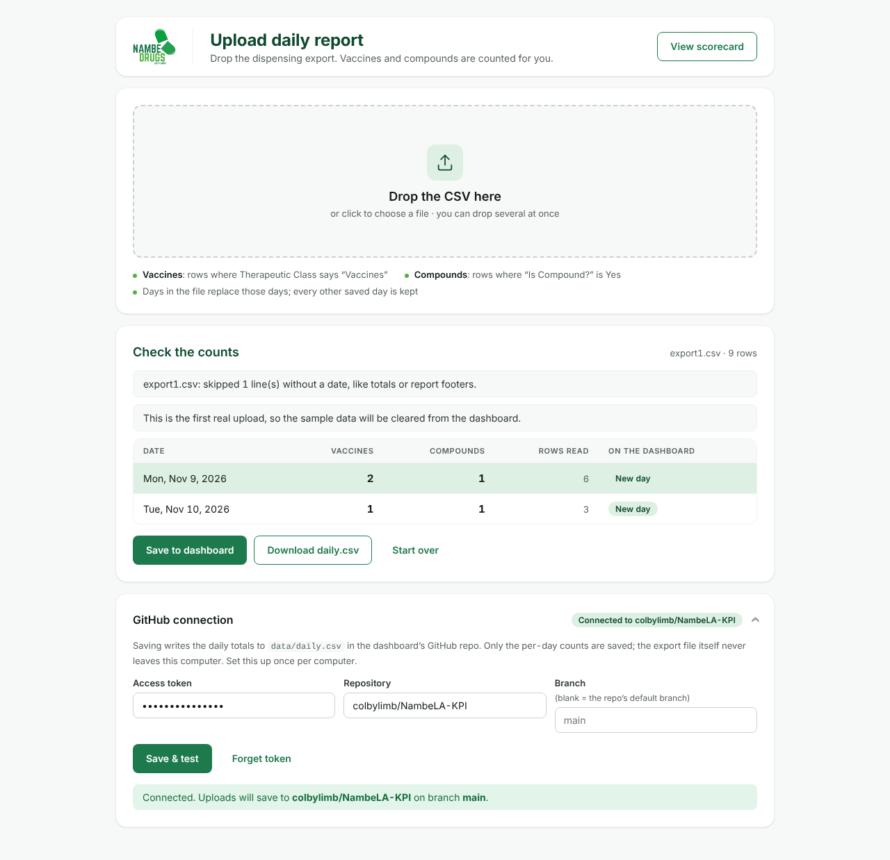

# Nambe Drugs Los Alamos: Daily Scorecard

A wall display for the team that shows **Rx processed**, **vaccines** and **compounds** each day and across each month, in the Nambe Drugs brand style.


## What's on the screen

For each of **Rx Processed**, **Vaccines** and **Compounds**:

| Tile / chart | What it shows | Compared with |
|---|---|---|
| **Today** (green tile, top) | Count for the latest day in the data | The same date last month (Nov 16 vs Oct 16) |
| **Month to date** | Total from the 1st through the latest day | The same days last month (Nov 1–16 vs Oct 1–16) |
| **Monthly totals** | The last 12 months. The current month shows the total so far (lime) and a dashed outline for where it's on pace to finish. | |

Counts are by the day each Rx was entered.

When last month is shorter, the comparison uses its last day. For example, Mar 31 compares to Feb 28, and Mar 1–31 compares to Feb 1–28.

## Updating the numbers: drop in the export

Open **`upload.html`** on the dashboard site (for example `https://<your-pages-url>/upload.html`) on any computer. This is the manual option; see *Automatic nightly update* below for the hands-off setup.



1. Drop the dispensing export (CSV) on the page, or click to choose it. You can drop several files at once.
2. Check the per-day counts it shows.
3. Click **Save to dashboard**.

How the export is counted:

| Count | Rule |
|---|---|
| **Rx Processed** | Every row with a date (one row per prescription) |
| **Vaccines** | Rows where **Therapeutic Class** contains "VACCINE" |
| **Compounds** | Rows where **Is Compound?** is **Yes** |
| **Day** | The **Dispensed Date** column |

Uploads **add to** what's already saved. They never wipe it.

- A day in the new file replaces that day's counts. Every other saved day is kept.
- Re-uploading the same file is safe because nothing gets double-counted. The table shows "Already saved."
- If you upload a corrected file for a day, that day's numbers update, and the table shows "Replaces …" so you can see the old values.
- The first real upload clears the sample data.
- To load history, export a longer date range (for example the last 12 months) and drop it once. That fills in the monthly chart and the last-month comparisons.

The export file itself never leaves your computer. The page counts it in the browser and saves only the per-day totals to `data/daily.csv`.

### One-time setup on the upload computer

The page saves to GitHub, so it needs an access token once per computer:

1. On GitHub, go to **Settings → Developer settings → Personal access tokens → Fine-grained tokens → Generate new token**.
2. Set **Repository access** to *Only select repositories* and choose this repo.
3. Under **Permissions**, set **Contents** to *Read and write*. Nothing else is needed.
4. Pick an expiration (up to a year), generate the token, and copy it.
5. On `upload.html`, open **GitHub connection**, paste the token, and click **Save & test**.

The token is stored only in that computer's browser. Use **Forget token** to remove it. When it expires, make a new one and paste it in the same place.

No token? Click **Download daily.csv** instead. Then on GitHub, open `data/daily.csv`, choose **Upload files**, and commit the downloaded file.

## Automatic nightly update (Outlook → Power Automate → GitHub)

The plan is hands-off. The pharmacy system emails the CSV export at 11:45 PM. At 11:59 PM a Power Automate flow counts it with an Office Script (which also keeps a backup table in a SharePoint Excel workbook) and writes the merged totals to `data/daily.csv`. It uses the same counting and merge rules as the upload page.

To set it up, paste [`docs/power-automate-setup-prompt.md`](docs/power-automate-setup-prompt.md) into a Claude chat and follow along.

## How the screen stays current

- The page re-reads `daily.csv` every 10 minutes, so the nightly update appears on its own. Nobody has to touch the TV.
- The header pill turns **amber** ("Waiting on nightly update") if it's after 12:30 AM and yesterday's row isn't in the file yet. It turns **red** if the file can't be loaded. In that case the last numbers stay on screen.
- The page fully reloads at 3 AM each night to pick up any design changes.
- The mouse cursor hides itself on the display.

## Hosting (GitHub Pages)

1. In the repo, go to **Settings → Pages**.
2. Set **Source** to *Deploy from a branch*, pick the branch and `/ (root)`, and click **Save**.
3. Open the URL GitHub shows on the TV's browser in full-screen or kiosk mode.

The page is laid out for a 55" 1920×1080 TV, with three columns and no scrolling. It scales to 4K. It also works on phones.

## Files

```
index.html          the TV dashboard
upload.html         drop-in page for the daily export
assets/ingest.js    counts Rx/vaccines/compounds and merges by date
assets/upload.js    upload page logic (saves via the GitHub API)
assets/styles.css   brand tokens and layout
assets/app.js       data loading, comparisons and charts (no libraries)
assets/logo.png     logo
data/daily.csv      the daily counts (written by the upload page)
```

## Preview locally

```bash
python3 -m http.server 8000
```

Then open http://localhost:8000.
