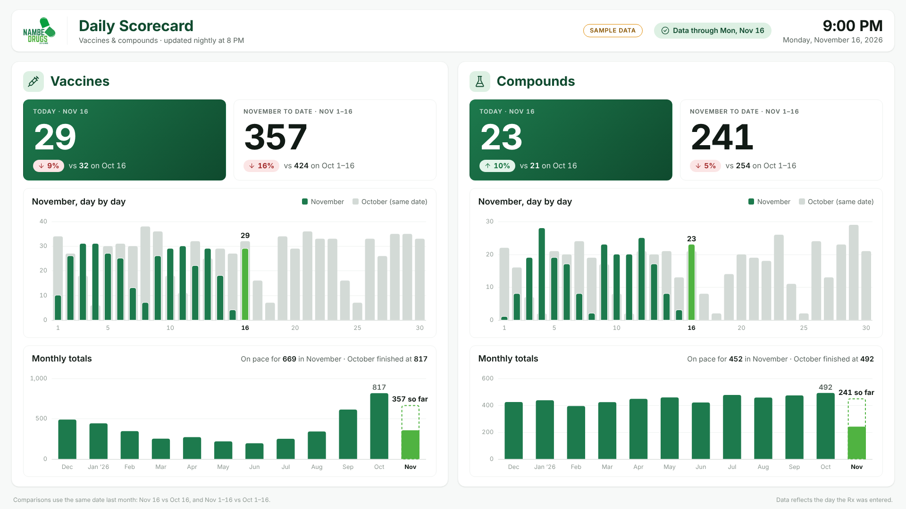

# Nambe Drugs Los Alamos: Daily Scorecard

A wall display for the team that shows **vaccines** and **compounds** each day and across each month, in the Nambe Drugs brand style.



## What's on the screen

For each of **Vaccines** and **Compounds**:

| Tile / chart | What it shows | Compared with |
|---|---|---|
| **Today** (green tile) | Count for the latest day in the data | The same date last month (Nov 16 vs Oct 16) |
| **Month to date** | Total from the 1st through the latest day | The same days last month (Nov 1–16 vs Oct 1–16) |
| **Day by day** | This month's daily bars (green), with last month's same dates as gray bars behind them. The latest day is lime. | |
| **Monthly totals** | The last 12 months. The current month shows the total so far (lime) and a dashed outline for where it's on pace to finish. | |

Counts are by the day each Rx was entered.

When last month is shorter, the comparison uses its last day. For example, Mar 31 compares to Feb 28, and Mar 1–31 compares to Feb 1–28.

## Updating the numbers (once a day at 8 PM)

All the data lives in one file: **`data/daily.csv`**. Add one line per day:

```
date,vaccines,compounds
2026-11-16,29,23
```

- Dates use `YYYY-MM-DD` format.
- To fix a day, edit its line. Rows can be in any order.
- A day with no line is treated as "no data". It isn't counted as 0.
- Lines that start with `#` are comments. While the first line includes the word **SAMPLE**, the header shows a "Sample data" badge. **Delete the sample rows and that comment line once you load real counts.**

The quickest way to update is in the browser on GitHub: open `data/daily.csv`, click the pencil icon, add the line, and click **Commit changes**. GitHub Pages republishes in about a minute.

## How the screen stays current

- The page re-reads `daily.csv` every 10 minutes, so the 8 PM update appears on its own. Nobody has to touch the TV.
- The header pill turns **amber** ("Waiting on 8 PM update") if it's after 8:30 PM and today's row isn't in the file yet. It turns **red** if the file can't be loaded. In that case the last numbers stay on screen.
- The page fully reloads at 3 AM each night to pick up any design changes.
- The mouse cursor hides itself on the display.

## Hosting (GitHub Pages)

1. In the repo, go to **Settings → Pages**.
2. Set **Source** to *Deploy from a branch*, pick the branch and `/ (root)`, and click **Save**.
3. Open the URL GitHub shows on the TV's browser in full-screen or kiosk mode.

The page is built for a 1920×1080 TV and scales to 4K. It also works on phones.

## Files

```
index.html          page shell
assets/styles.css   brand tokens and layout
assets/app.js       data loading, comparisons and charts (no libraries)
assets/logo.png     logo
data/daily.csv      the daily counts (edit this)
```

## Preview locally

```bash
python3 -m http.server 8000
```

Then open http://localhost:8000.
